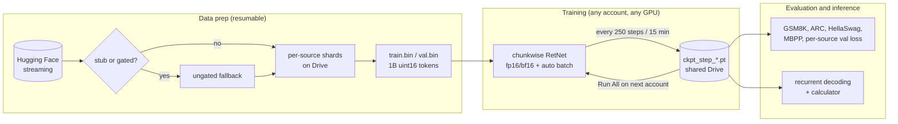

# retnet-300m: a 310M-parameter RetNet 2.0 for code and math, trained on free Colab GPUs

A from-scratch PyTorch implementation of a **~310M-parameter Retentive Network (RetNet)** language model. It has three additions aimed at code and multi-step math:
- **Delta-rule memory** with negative eigenvalues (`β_max = 2`)
- **Short causal convolution** (`K = 4`)
- **Calculator in the loop**: arithmetic is computed exactly at decode time instead of predicted

The model is pretrained on synthetic textbooks, code and step-by-step reasoning data. The whole pipeline is built to run on **free-tier hardware only**: a 16 GB Colab T4 GPU and 15 GB of Google Drive per account, rotated across several Google accounts.

> **Status:** model, data pipeline, training loop, multi-account checkpointing and evaluation are implemented and covered by 146 unit/integration tests (CPU). Pretraining on Colab is the next step; results will be added here once runs finish.


## Highlights

- **Three equivalent ways to compute retention**: parallel, chunkwise and recurrent. Tests check they agree to ~1e-9 in float64. Training uses chunkwise mode (memory linear in sequence length). Inference uses recurrent mode: constant memory per token, no KV cache.
- **Delta-rule memory inside chunkwise training**: the within-chunk delta-rule dependencies reduce to one batched unit-lower-triangular solve (`torch.linalg.solve_triangular`). The recurrence is never unrolled.
- **Calculator in the loop**: training data rewrites correct arithmetic as `<<16*47=752>>752`. At inference an AST-based evaluator (no `eval`) fills in the result. Feeding those tokens only extends the recurrent state; no cache is rebuilt.
- **Fault-tolerant training on preemptible, quota-limited GPUs**: versioned checkpoints that any account can write, fallback past corrupted files, data prep that resumes partway through a source, and an auto-sized micro-batch for whichever GPU the session gets.
- **Ready for post-training**: 16 reserved token ids so latent-thought (`<bot>`/`<eot>`) or pause tokens can be added later without re-tokenizing 1B tokens.

## Resource constraints and how the design handles them

| Constraint | Effect | How the project handles it |
|---|---|---|
| **Free Colab T4**: 16 GB VRAM, Turing (no fast bf16), ~12 GB RAM | A 310M model with AdamW and 1024-token sequences barely fits | fp16 + `GradScaler` on T4 (bf16 on L4/A100); retention core kept in fp32 for stability; the largest micro-batch that fits is measured at startup and activation checkpointing is enabled only if needed. Effective batch stays fixed at 32 × 1024 tokens on any GPU |
| **Session limits and daily GPU quota** | Training is cut off every few hours | Work is spread across several Google accounts sharing one Drive folder. **Run All** on any account resumes from the newest valid checkpoint. Checkpoints are saved every 250 steps / 15 min and on stop signals |
| **15 GB Drive per account; files owned by the account that wrote them** | Can't overwrite or delete another account's files; deleted files still count in Trash | Each checkpoint is a new step-numbered file. Old ones are truncated to 0 bytes before deleting. AdamW moments are stored in bf16 (checkpoint ~2.5 GB, 2 kept) |
| **Disconnects mid-write** | Truncated checkpoints and half-built datasets | Staged on local SSD and fsynced; the loader skips corrupt checkpoints; data prep saves progress every 30 s and resumes from the same row |
| **Compute budget** | Default run is 0.5B tokens, well below the ~6B Chinchilla-optimal for 310M params | Data restricted to dense, curated sources (textbooks, code, worked math) to get more from each token; a 125M preset gives cheaper comparisons |
| **Gated or unfinished datasets** | Some `nampdn-ai/tiny-*` sets are gated; `tiny-math-textbooks` currently serves `[Not ready yet!]` placeholder rows | Each source is probed first and swapped for an ungated fallback (e.g. FineMath-4+) when needed; shards averaging < 32 tokens/doc are rejected |

## Pipeline



## Repository layout

| Path | What it holds |
|---|---|
| `retnet/retention.py` | Multi-scale retention: parallel / chunkwise / recurrent, delta rule, short conv |
| `retnet/model.py` | Decoder stack, size presets (300m, 300m-deep, 125m, 30m), generation |
| `retnet/calculator.py` | Safe AST evaluator, calculator-in-the-loop decoding, arithmetic annotation |
| `retnet/checkpoint.py` | Multi-account checkpoint save/load/rotation |
| `scripts/prepare_mix.py` | Resumable data prep and tokenizer training |
| `scripts/train.py`, `scripts/eval.py`, `scripts/chat.py` | Training, evaluation suite, interactive chat |
| `colab/retnet_300m_shared.ipynb` | One-click Colab notebook (Run All on any account) |
| `tests/` | Mode equivalence, delta memory, calculator, checkpoint recovery, data-prep resume |

---

## 1. Why RetNet 2.0 Features (Delta Memory + Short Conv + Calculator) Are Essential

Plain RetNet (Sun et al., 2023) updates its per-head state via a purely additive recurrence:
$$S_t = \gamma S_{t-1} + k_t^T v_t, \qquad \gamma \in (0, 1)$$
While fast ($O(1)$ recurrent inference, parallel/chunkwise training), plain additive retention has two fundamental weaknesses on coding and reasoning tasks:
1. **Inability to overwrite variables (Associative Recall)**: When code or a reasoning trace updates a variable (`x = 3 ... x = 7`), additive state blends old and new values. **Delta-Rule Memory (`--memory delta`)** uses:
   $$S_t = \gamma S_{t-1} + \beta_t k_t^T (v_t - \gamma k_t S_{t-1})$$
   which erases the old value associated with key $k_t$ before writing $v_t$. During training, chunkwise mode solves the within-chunk dependencies in parallel via a fast batched unit-lower-triangular solve (`torch.linalg.solve_triangular`).
2. **State tracking & negative eigenvalues (`--beta_max 2.0`)**: With write strength $\beta_t \in (0, 2)$, the state transition matrix $(I - \beta_t k_t k_t^T)$ admits eigenvalues in $(-1, 1)$, unlocking parity, counters, boolean toggling, and nested control-flow tracking (Grazzi et al., 2024).
3. **Short Causal Depthwise Convolution (`--short_conv 4`)**: Mixes a 4-token local window before $q, k, v$ projections so keys can bind a variable name token with `=` and its value token.
4. **AST Calculator-in-the-Loop + Digit-Splitting BPE (`retnet/calculator.py`)**:
   - Every digit (`0`–`9`) is tokenized individually and `<<`, `>>`, `=` are isolated tokens.
   - Worked arithmetic in training corpora is rewritten into `<<expr=result>>result` (`annotate_arithmetic`).
   - At inference (`generate_with_calculator` / `generate_batch_greedy`), whenever the model emits `<<expr=`, the safe AST parser computes the exact value and injects `result>>` directly into the recurrent state in $O(1)$ without rebuilding any KV cache.

---

## 2. High-Quality Data Mix (`nampdn-ai/tiny-series` + Reasoning Only)

`scripts/prepare_mix.py` streams strictly textbook-grade, coding, and reasoning datasets (no noisy raw web scrapes):

| Source Key | Hugging Face Dataset | Description | Default Share |
|---|---|---|---|
| `tiny_codes` | `nampdn-ai/tiny-codes` | ~1.6M well-commented code & control-flow reasoning snippets | **24%** |
| `tiny_math_textbooks` | `nampdn-ai/tiny-math-textbooks` | Synthetic math textbooks (calculator-annotated). Currently serves placeholder rows, so `HuggingFaceTB/finemath` (4+) is used automatically | **20%** |
| `tiny_textbooks` | `nampdn-ai/tiny-textbooks` | ~420k foundational synthetic textbooks (`textbook` column extracted) | **14%** |
| `tiny_code_textbooks` | `nampdn-ai/tiny-code-textbooks` | ~207k synthetic programming textbooks explaining code step-by-step | **12%** |
| `metamath` | `meta-math/MetaMathQA` | Step-by-step math Q&A with arithmetic rewritten as `<<a*b=c>>c` | **12%** |
| `tiny_orca_textbooks` | `nampdn-ai/tiny-orca-textbooks` | ~147k step-by-step analytical reasoning textbooks | **10%** |
| `magicoder` | `ise-uiuc/Magicoder-OSS-Instruct-75K` | Algorithmic & software engineering problem-solution pairs | **4%** |
| `tiny_lessons` | `nampdn-ai/tiny-lessons` | Bite-sized structured Markdown lessons & examples | **2%** |
| `gsm8k` | `openai/gsm8k` (`train` split only) | Grade-school math word problems with native `<<a*b=c>>c` calls | **2%** |

*(Optional: `tiny_strange_textbooks` (`nampdn-ai/tiny-strange-textbooks`) can also be enabled via `--shares`.)*

---

## 3. Running Across Multiple Google Colab Accounts via a Shared Drive Folder

### Why naive single-file checkpointing (`ckpt.pt`) breaks across Google accounts
When **Account A** creates `ckpt.pt` in a shared Google Drive folder, Account A is the **file owner**. When **Account B** mounts the same shared folder as an **Editor**:
1. **Cross-account `os.replace` / `unlink` permission error**: Google Drive FUSE often forbids a non-owner Editor from unlinking or `os.replace`-ing a file owned by Account A (`PermissionError: [Errno 13] Permission denied`).
2. **Mid-sync Colab disconnects**: Writing a ~2.4 GB checkpoint over FUSE takes 20–40 seconds; if Account A disconnects mid-write, a single `ckpt.pt` is left corrupted.
3. **Cross-GPU (`T4` fp16 vs `L4`/`A100` bf16) `GradScaler` crash**: Resuming a `bf16` checkpoint (where `GradScaler` was disabled and saved `{}`) on a `T4` (where `GradScaler` is enabled for `fp16`) crashes PyTorch if `scaler.load_state_dict({})` is called unconditionally.
4. **Google Drive 15 GB Quota & Trash bloat**: Deleting multi-GB files without truncating them first fills up the owner's 15 GB Drive Trash.

### How `retnet-300m` solves all four
1. **Versioned Step Checkpoints (`ckpt_step_XXXXXXX.pt`) + Multi-Candidate Fallback Loader (`retnet/checkpoint.py`)**:
   - Every checkpoint is staged to local SSD (`/tmp`) first, then written as a new step-numbered file `ckpt_step_0000250.pt` (owned by the active account, so no cross-account overwrite permission is needed) and flushed via `os.fsync`.
   - On resume (`load_latest_checkpoint`), all `ckpt_step_*.pt` files are scanned from highest step to lowest; if the newest file was truncated by a sudden Colab disconnect, training automatically falls back to the previous valid checkpoint.
2. **Zero-Byte Truncation Before Rotation**:
   - Before pruning checkpoints older than `--keep_ckpts 2`, we first truncate the file to **0 bytes** (`f.truncate(0)` + `os.fsync`). In Google Drive shared folders, Editors *are* permitted to truncate file contents owned by another account even when `unlink` is restricted—and if `unlink` moves the file to Trash, it occupies **0 bytes** of Drive quota.
3. **Compact `bfloat16` Optimizer State (`compact_optimizer_state`)**:
   - AdamW moment buffers (`exp_avg`, `exp_avg_sq`) are saved in `bfloat16` on disk and restored to `fp32` on load, shrinking each 300M checkpoint from ~3.6 GB to ~2.4 GB.
4. **Cross-GPU (`T4` $\leftrightarrow$ `L4`/`A100`) & Auto-Batch Compatibility**:
   - `pick_batch_size` measures the largest micro-batch that fits the current account's GPU (automatically enabling per-block activation checkpointing `--grad_ckpt` on 16 GB T4 GPUs if needed) while keeping `seqs_per_step = 32` constant.
   - `GradScaler` state is only loaded when switching into `fp16` if the checkpoint actually contains a non-empty `scale` state.

---

### Step-by-Step Multi-Account Colab Setup

1. **Build the Colab bundle locally**:
   ```bash
   bash scripts/make_colab_bundle.sh   # -> dist/retnet-300m-colab.zip
   ```
2. **On Account 1 (Owner)**:
   - In Google Drive, create folder **`My Drive/retnet-300m/`**.
   - Upload **`dist/retnet-300m-colab.zip`** into `My Drive/retnet-300m/`.
   - Right-click **`retnet-300m`** $\rightarrow$ **Share** $\rightarrow$ add Account 2, Account 3, ... with **Editor** access.
3. **On Account 2, Account 3, ... (Collaborators)**:
   - Open Google Drive $\rightarrow$ **Shared with me**.
   - Right-click **`retnet-300m`** $\rightarrow$ **Organize** $\rightarrow$ **Add shortcut** $\rightarrow$ select **My Drive** $\rightarrow$ click **Add**.
4. **Run in Google Colab (from any account)**:
   - Open `colab/retnet_300m_shared.ipynb` in Colab, select a GPU runtime (`T4`, `L4`, or `A100`), and click **Runtime $\rightarrow$ Run all**.
   - When an account's GPU session ends, open the notebook on the next account and click **Runtime $\rightarrow$ Run all**—it verifies the cached dataset on Drive, finds the latest valid `ckpt_step_XXXXXXX.pt`, adapts the micro-batch to the new GPU, and continues training.
5. **After any code change**: rerun `bash scripts/make_colab_bundle.sh` and upload the new zip, replacing the old one on Drive. Also re-open the notebook from `colab/`. The notebook prints `Code bundle: version …, git …` and stops if the zip on Drive is older than it expects.

### Data preparation resumes mid-source
`scripts/prepare_mix.py` tokenizes each source into its own shard in the Drive shard cache (`data/tinymix_shards/`). Every 30 s it fsyncs the partial shard and writes `<source>.progress.json`. After a disconnect, the next Run All continues from that point. It does not restart the source. Sources that return placeholder rows are swapped for their ungated fallback. At the time of writing, `nampdn-ai/tiny-math-textbooks` returns `[Not ready yet!]` placeholder rows. Cached shards that average under 32 tokens per document are rebuilt.

### Reserved tokens for post-training
The tokenizer reserves ids 1–16 (`<|reserved_0|>` … `<|reserved_15|>`, right after `<|endoftext|>` = 0). They never appear in pretraining text. They are kept for post-training, for example latent-thought markers (`reserved_0` = `<bot>`, `reserved_1` = `<eot>`) or pause tokens, so those can be added without changing the tokenizer or re-tokenizing the corpus. `meta.json` lists them under `special_tokens`. A cached tokenizer without them is set aside as `tokenizer.legacy.json` and retrained. Shards record the fingerprint of the tokenizer that built them and are rebuilt if it changes.
